# Sistema de Tickets — Documentación técnica y funcional

> Documentación del Sistema de Tickets.
> Describe el estado del proyecto en la rama `main`.

Este documento tiene dos usos:

- **Explicar el proyecto al cliente** sin entrar en código: secciones 1, 6, 9 y 14.
- **Entender la implementación** para mantenerla o defenderla: secciones 2 a 13.

Los diagramas están en Mermaid. GitHub, VS Code, Obsidian y la mayoría de visores Markdown los renderizan directamente.

## Índice

1. [Qué es el sistema](#1-qué-es-el-sistema)
2. [Stack y librerías](#2-stack-y-librerías)
3. [Backend por dentro](#3-backend-por-dentro)
4. [Autenticación con JWT](#4-autenticación-con-jwt)
5. [Base de datos](#5-base-de-datos)
6. [Ciclo de vida del ticket](#6-ciclo-de-vida-del-ticket)
7. [Mensajes, HTML y adjuntos](#7-mensajes-html-y-adjuntos)
8. [Notificaciones y correo](#8-notificaciones-y-correo)
9. [Analíticas](#9-analíticas)
10. [Exportación a PDF](#10-exportación-a-pdf)
11. [Frontend por dentro](#11-frontend-por-dentro)
12. [Seguridad](#12-seguridad)
13. [Operación y pruebas](#13-operación-y-pruebas)
14. [Guion de demo para el cliente](#14-guion-de-demo-para-el-cliente)
15. [Glosario y limitaciones](#15-glosario-y-limitaciones)

---

## 1. Qué es el sistema

Mesa de ayuda interna para registrar, atender y cerrar incidencias. No hay registro público: un administrador crea las cuentas.

Intervienen tres roles:

- **Usuario:** reporta incidencias y responde en sus propios tickets.
- **Soporte:** atiende tickets sin asignar o asignados a él, propone soluciones y cierra los suyos.
- **Administrador:** supervisa todo, reasigna, edita, cierra y reabre tickets, administra usuarios y catálogos, y consulta la auditoría.

Cada ticket recorre un ciclo con reglas aplicadas en el servidor, no solo en la interfaz. Un ticket guarda su conversación, sus adjuntos, su historial de cambios y las notificaciones que genera.

### 1.1 Arquitectura

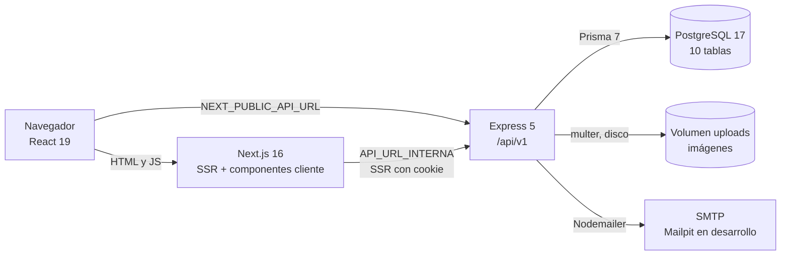

Hay dos caminos de datos que conviene distinguir:

1. **Navegador a API directa.** Formularios, botones y el editor llaman a `NEXT_PUBLIC_API_URL` con `fetch` y el token en `Authorization`.
2. **Navegador a Next.js a API.** Las páginas se renderizan en el servidor. Next lee la cookie de sesión y consulta la API por la red interna de Docker (`API_URL_INTERNA`).

El frontend nunca habla con PostgreSQL. Toda regla de negocio vive en el backend.

---

## 2. Stack y librerías

### 2.1 Backend

| Librería | Versión | Para qué | Dónde |
| --- | --- | --- | --- |
| `express` | 5.2.1 | Servidor HTTP y enrutado | `src/app.ts`, `src/routes/` |
| `prisma` + `@prisma/client` | 7.10.0 | ORM, migraciones y cliente tipado | `prisma/`, `src/db/prisma.ts` |
| `@prisma/adapter-pg` | 7.10.0 | Driver de PostgreSQL para Prisma 7 | `src/db/prisma.ts` |
| `argon2` | 0.45.1 | Hash de contraseñas | `usuarios.service.ts`, `autenticacion.service.ts` |
| `jsonwebtoken` | 9.0.3 | Firma y verificación del JWT | `autenticacion.service.ts`, `auth.middleware.ts` |
| `zod` | 4.6.5 | Validación de cuerpos, consultas y variables de entorno | `*.schema.ts`, `config/env.ts` |
| `multer` | 2.5.0 | Subida de imágenes multipart | `config/uploads.ts` |
| `sanitize-html` | 2.18.1 | Limpieza del HTML de los mensajes | `utils/sanitizar-html.ts` |
| `nodemailer` | 10.3.1 | Envío de correo SMTP | `services/correo/` |
| `cors` | 2.8.6 | Permitir el origen del frontend | `app.ts` |
| `morgan` | 1.12.1 | Log de peticiones HTTP | `app.ts` |
| `dotenv` | 18.0.6 | Carga de `.env` | `config/env.ts` |

### 2.2 Frontend

| Librería | Versión | Para qué | Dónde |
| --- | --- | --- | --- |
| `next` | 16.4.2 | SSR, rutas y build | `app/` |
| `react` / `react-dom` | 19.3.0 | Interfaz | `app/`, `components/` |
| `tailwindcss` | 4.x | Estilos utilitarios | `app/globals.css` |
| `radix-ui` + `shadcn` | 1.8.1 / 4.23.0 | Primitivas accesibles y componentes base | `components/ui/` |
| `react-hook-form` + `@hookform/resolvers` | 7.91.0 | Formularios y validación | `components/` |
| `zod` | 4.6.7 | Esquemas de formulario | `lib/`, `components/` |
| `@tiptap/*` | 3.32.2 | Editor de mensajes enriquecidos | `components/tickets/editor-mensaje.tsx` |
| `recharts` | 3.8.0 | Gráficas de analíticas | `components/analiticas/graficas-dashboard.tsx` |
| `jspdf` + `jspdf-autotable` | 4.2.1 / 5.0.9 | Reporte PDF en el navegador | `components/analiticas/boton-exportar-pdf.tsx` |
| `sonner` | 2.0.8 | Avisos tipo toast | `app/layout.tsx`, componentes |
| `lucide-react` | 1.63.0 | Iconografía | `components/` |
| `class-variance-authority` + `cn` | 0.7.1 / 0.5.0 | Variantes de componentes y unión de clases | `components/ui/` |
| `next-themes` | 0.4.6 | Tema del componente Sonner; el modo oscuro no está habilitado | `components/ui/sonner.tsx` |

### 2.3 Pruebas

| Herramienta | Uso |
| --- | --- |
| `vitest` | Runner en backend y frontend |
| `supertest` | Peticiones HTTP contra la app Express en pruebas de integración |
| `@testcontainers/postgresql` | PostgreSQL 17 desechable y real para integración |
| `@testing-library/react` + `user-event` | Pruebas de componentes en jsdom |
| `jsdom` | Entorno DOM simulado para el frontend |

### 2.4 Por qué estas librerías

- **Argon2** en lugar de SHA o bcrypt: es resistente a ataques con GPU y memoria, y es el algoritmo recomendado para contraseñas nuevas.
- **`jsonwebtoken`** es el estándar de facto en Node para tokens firmados; el payload se valida después con Zod para no confiar en su forma.
- **Zod** se usa en el backend y en el frontend con el mismo estilo de esquema, lo que reduce discrepancias entre lo que envía la interfaz y lo que acepta la API.
- **Prisma** genera tipos desde el schema; un cambio de columna rompe la compilación, no la ejecución.
- **`sanitize-html`** permite guardar HTML del editor sin abrir la puerta a XSS.
- **TipTap** da un editor con formato e imágenes sin acoplar la interfaz a un servicio externo.
- **Recharts y jsPDF** evitan un servicio de reportes: las gráficas y el PDF se generan en el navegador.

---

## 3. Backend por dentro

### 3.1 Capas

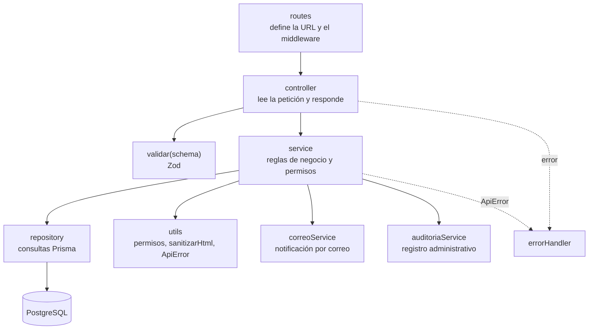

Una petición típica:

1. `app.ts` monta `/api/v1` y aplica `Cache-Control: no-store`.
2. El router del módulo aplica `authMiddleware`.
3. El controlador obtiene el usuario de `req.usuario`, valida con `validar(...)` y llama al servicio.
4. El servicio aplica permisos, reglas y notificaciones.
5. El repositorio consulta Prisma.
6. El controlador responde `{ message, data }` o `{ data, meta }`.
7. Si algo falla, `errorHandler` convierte `ApiError` o `ZodError` en JSON con el código correcto.

Express 5 propaga automáticamente los rechazos de promesas al middleware de errores, así que los controladores no repiten `try/catch`.

### 3.2 Módulos

| Módulo | Responsabilidad |
| --- | --- |
| `autenticacion` | Login, firma JWT y perfil del usuario actual |
| `usuarios` | Alta, edición, baja, reactivación y listado |
| `roles` | Catálogo de roles |
| `areas` | Catálogo de áreas, con activación |
| `categorias` | Catálogo de categorías |
| `tickets` | Tickets, asignación, mensajes, historial, adjuntos y notificaciones |
| `analiticas` | Métricas del dashboard y filtros |
| `auditoria` | Registro de acciones administrativas |

### 3.3 Validación y errores

- `validar(schema, datos)` lanza `ApiError(400)` con los `issues` de Zod.
- `requerirId` valida que un parámetro sea UUID antes de consultar.
- `obtenerUsuario` lanza `401` si no hay sesión.
- `ApiError` transporta `status`, `message` e `issues` opcionales.
- `errorHandler` distingue `ApiError`, `ZodError` y errores inesperados. Los inesperados se registran y devuelven `500` sin filtrar detalles.

### 3.4 Dónde viven los permisos

No hay middleware de roles. Las rutas solo aplican autenticación. Los permisos se comprueban en servicios y controladores:

- `exigirAdministrador(rol)` en usuarios, áreas, categorías y roles.
- `puedeVerTicket(ticket, usuario)` en tickets y adjuntos.
- Reglas específicas dentro de `TicketsService`.

Esto permite combinar reglas de negocio con la comprobación de rol en el mismo punto, y evita un middleware distinto por endpoint.

---

## 4. Autenticación con JWT

### 4.1 Secuencia de login

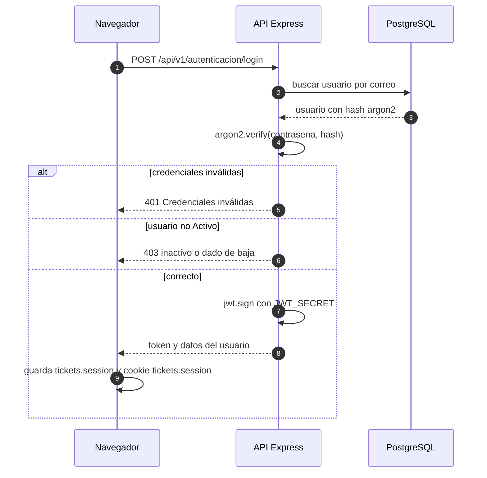

El login se hace desde el navegador contra la API, no a través de Next. El formulario guarda la sesión en `localStorage` y escribe una cookie del mismo nombre para que los Server Components puedan leerla.

### 4.2 Contenido del token

```json
{
  "id": "uuid-del-usuario",
  "nombre": "Laura",
  "correo_electronico": "laura@example.com",
  "rol": "Soporte",
  "iat": 1760000000,
  "exp": 1760003600
}
```

- Firma HS256 con `JWT_SECRET`.
- Duración `JWT_EXPIRES_IN`, por defecto 3600 segundos.
- El esquema de validación del payload vuelve a comprobar los cuatro campos con Zod.
- No se incluye la contraseña ni datos sensibles.

### 4.3 Middleware

`auth.middleware.ts`:

1. Exige `Authorization: Bearer <token>`.
2. Verifica la firma con `jwt.verify`.
3. Valida la forma del payload.
4. Asigna el usuario a `req.usuario`.
5. Cualquier fallo devuelve `401`.

### 4.4 Sesión en el cliente

- Clave única: `tickets.session`. Nunca se renombra.
- La cookie no es `httpOnly`: la escribe el cliente para que Next la lea. Es una decisión de este proyecto escolar, no de producción.
- El cliente decodifica el `exp` del token y descarta la sesión si venció. Se hace solo en el navegador para evitar errores de prerender.
- Al recibir `401` en una llamada, el cliente cierra sesión y redirige a `/login?motivo=expirada`.
- No hay refresh token. Token vencido significa volver a entrar.
- El usuario puede cambiar su contraseña desde `/perfil`. El administrador puede generar una temporal nueva desde `/users`.

---

## 5. Base de datos

Diez tablas. Nombres en español y en plural, tal como están en PostgreSQL.

### 5.1 Diagrama entidad-relación

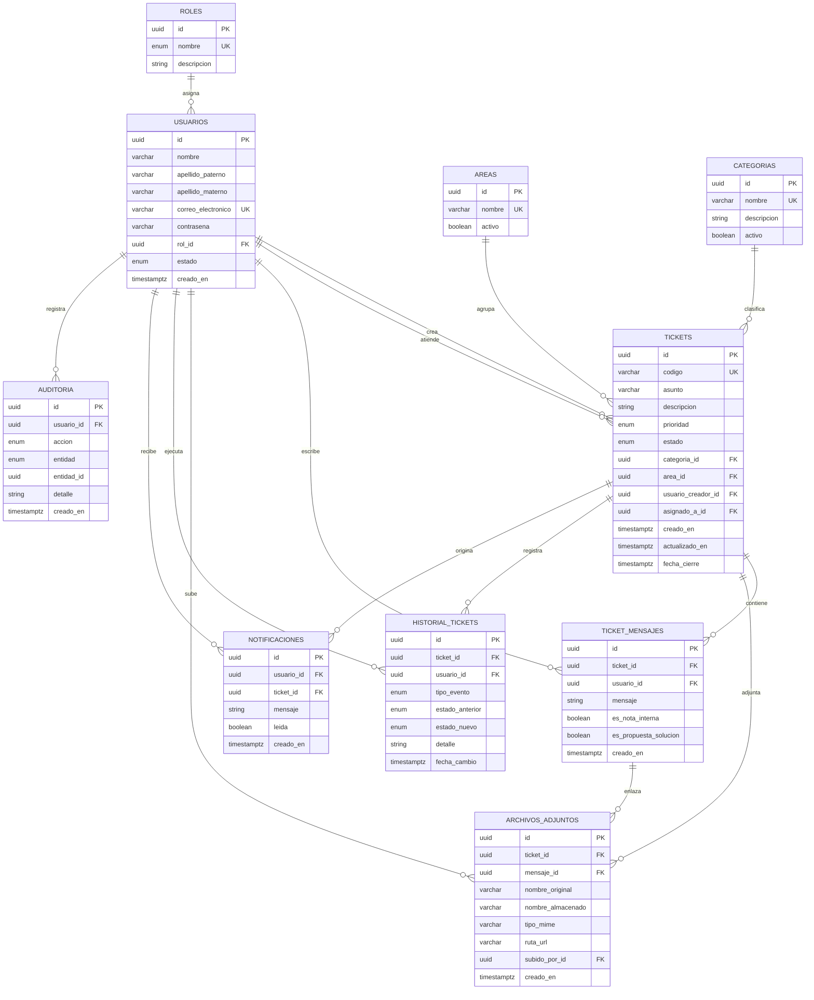

### 5.2 Diccionario de tablas

| Tabla | Qué guarda | Campos clave |
| --- | --- | --- |
| `roles` | Los tres roles del sistema | `nombre` único: Administrador, Soporte, Usuario |
| `usuarios` | Personas con acceso | `correo_electronico` único, `contrasena` con hash, `estado` |
| `areas` | Áreas de la organización | `activo` permite retirar un área sin borrarla |
| `categorias` | Tipo de incidencia | `nombre` único, `activo` |
| `tickets` | La incidencia | `codigo` único, `estado`, `prioridad`, creador y asignado |
| `ticket_mensajes` | Conversación | `es_nota_interna`, `es_propuesta_solucion` |
| `archivos_adjuntos` | Imágenes | `mensaje_id` nulo mientras está suelto |
| `historial_tickets` | Auditoría del ticket | `tipo_evento`, estado anterior y nuevo |
| `notificaciones` | Bandeja interna | `leida`, `usuario_id`, `ticket_id` |
| `auditoria` | Acciones del administrador | `accion`, `entidad`, `usuario_id`, `creado_en` |

### 5.3 Enums

| Enum | Valores | Uso |
| --- | --- | --- |
| `EstadoUsuario` | `Activo`, `Inactivo`, `Baja` | Solo `Activo` puede iniciar sesión |
| `EstadoTicket` | `Abierto`, `En_proceso`, `En_revision`, `Resuelto`, `Cerrado` | `Resuelto` es legado; ningún endpoint lo produce |
| `PrioridadTicket` | `Baja`, `Media`, `Alta`, `Critica` | Orden y filtros |
| `NombreRol` | `Administrador`, `Soporte`, `Usuario` | Permisos |
| `TipoEventoHistorial` | `CREACION`, `CAMBIO_ESTADO`, `REASIGNACION`, `CAMBIO_PRIORIDAD`, `PROPUESTA_SOLUCION` | Timeline |
| `AccionAuditoria` | `CREAR`, `EDITAR`, `BAJA`, `REACTIVAR`, `RESTABLECER_CONTRASENA`, `REABRIR` | Auditoría |
| `EntidadAuditoria` | `USUARIO`, `AREA`, `CATEGORIA`, `TICKET` | Auditoría |

### 5.4 Índices

| Índice | Motivo |
| --- | --- |
| `tickets(creado_en, id)` | Paginación estable por fecha descendente |
| `tickets(estado)` | Filtro por estado |
| `tickets(prioridad)` | Filtro y orden por prioridad |
| `tickets(categoria_id)`, `tickets(area_id)` | Filtros de catálogo |
| `tickets(usuario_creador_id)`, `tickets(asignado_a_id)` | Visibilidad por rol |
| Índices por `ticket_id` en mensajes, adjuntos, historial y notificaciones | Consultas del detalle |
| `usuarios(rol_id)` | Listado y filtros por rol |
| `auditoria(creado_en)`, `auditoria(usuario_id)`, `auditoria(entidad, entidad_id)` | Consulta del historial |

### 5.5 Integridad referencial

| Relación | Acción al borrar | Efecto práctico |
| --- | --- | --- |
| `usuarios.rol_id` | `Restrict` | No se borra un rol en uso |
| `tickets.usuario_creador_id` | `Restrict` | No se borra un usuario con tickets |
| `tickets.asignado_a_id` | `SetNull` | Si se borra el Soporte, el ticket queda sin asignar |
| `tickets.area_id` | `SetNull` | Un área borrada deja el ticket sin área |
| `ticket_mensajes.ticket_id` | `Cascade` | Borrar el ticket borra su conversación |
| `archivos_adjuntos.ticket_id` | `Cascade` | Borrar el ticket borra sus adjuntos |
| `archivos_adjuntos.mensaje_id` | `SetNull` | Si se borra el mensaje, la imagen queda suelta |
| `historial_tickets.ticket_id` | `Cascade` | El historial sigue al ticket |
| `notificaciones.usuario_id` | `Cascade` | Borrar el usuario borra su bandeja |
| `notificaciones.ticket_id` | `SetNull` | La notificación sobrevive sin enlace al ticket |
| `auditoria.usuario_id` | `Restrict` | No se borra un usuario con registros de auditoría |

En la práctica los usuarios no se borran: pasan a `Baja`. La baja conserva historial y trazabilidad.

### 5.6 Migraciones

1. `20261103051343_init` — estructura base.
2. `20261103062340_flujo_tickets` — ciclo, mensajes, adjuntos, historial y notificaciones.
3. `20261103225710_indice_tickets_paginacion` — índice de paginación.
4. `20261112000854_categorias_activo` — estado activo de las categorías.
5. `20261112001448_auditoria` — tabla de auditoría.

El servicio `migrate` de Compose ejecuta `prisma migrate deploy` y el seed en cada arranque. El seed es idempotente, pero restablece las contraseñas de las tres cuentas base.

---

## 6. Ciclo de vida del ticket

### 6.1 Estados

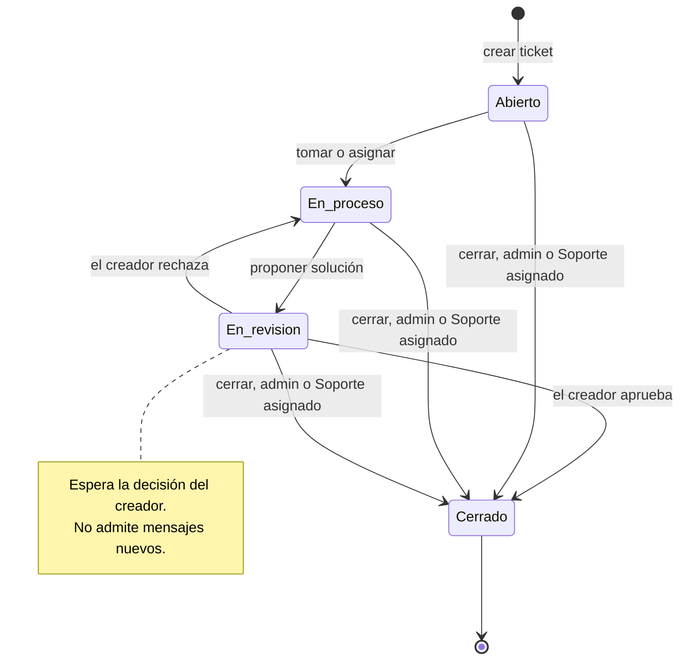

`Resuelto` existe en el enum y en datos antiguos, pero ningún endpoint lo genera. Los tickets cerrados y los resueltos rechazan mensajes y adjuntos con `400`.

### 6.2 Secuencia completa

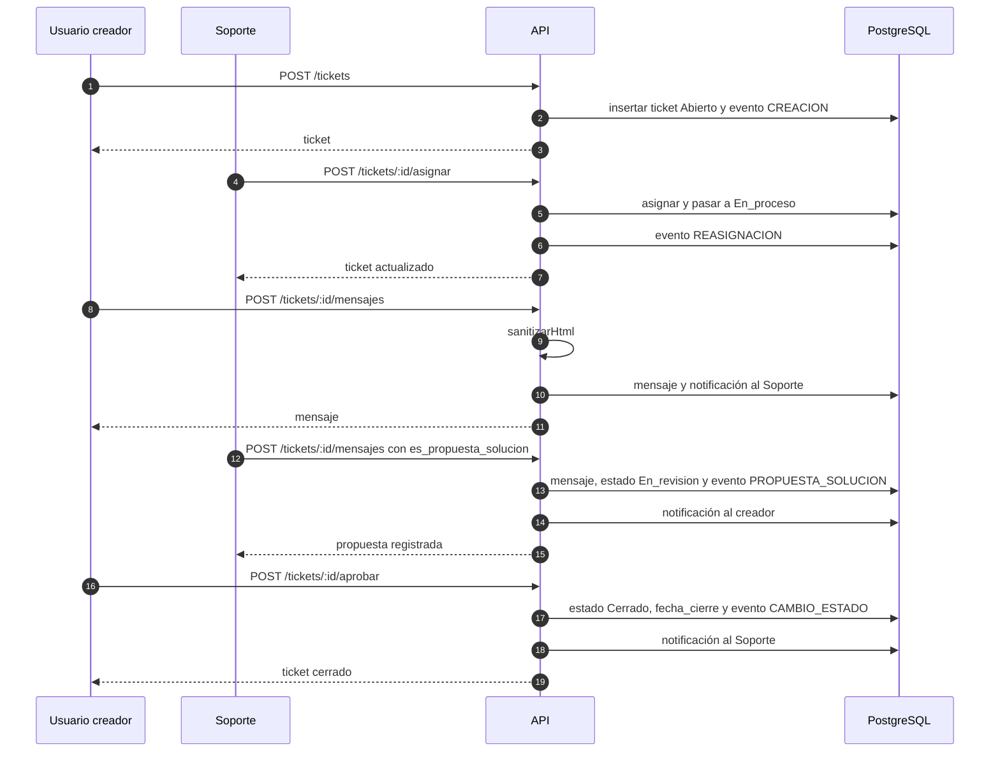

### 6.3 Quién puede hacer qué

| Acción | Usuario | Soporte | Administrador |
| --- | --- | --- | --- |
| Ver tickets | Solo los que creó | Sin asignar o asignados a él | Todos |
| Crear ticket | Sí | Sí | Sí |
| Editar asunto, prioridad, área o categoría | No | No | Sí |
| Asignar | No | Solo a sí mismo, si está libre | A cualquier Soporte |
| Responder | En sus tickets | Solo si lo tomó | En cualquiera |
| Nota interna | No | Sí | Sí |
| Proponer solución | No | Solo asignado y en `En_proceso` | No |
| Aprobar o rechazar | Solo el creador, en `En_revision` | No | No |
| Cerrar | No | Solo si está asignado | Cualquiera |
| Reabrir un ticket cerrado | No | No | Sí |
| Gestionar usuarios y catálogos | No | No | Sí |
| Consultar la auditoría | No | No | Sí |

Detalles que suelen preguntar:

- **Soporte debe tomar el ticket antes de responder.** Si no, `403`.
- **Asignar un ticket `Abierto` lo pasa a `En_proceso`.** Reasignar no cambia el estado.
- **Solo se puede asignar a usuarios con rol Soporte.** Asignar a Usuario o a Administrador devuelve `400`.
- **El cierre solo se hace con `PATCH /tickets/:id/estado` y `{ "estado": "Cerrado" }`.** Cualquier otro estado devuelve `400` porque tiene su propio endpoint.
- **Aprobar también cierra.** No existe un estado `Resuelto` producido por la aplicación.
- **La edición de campos no cambia el estado** y no está limitada por el estado actual.
- **Reabrir un ticket cerrado** lo devuelve a `En_proceso` si tiene Soporte y a `Abierto` si no, con historial y notificación.

### 6.4 Visibilidad

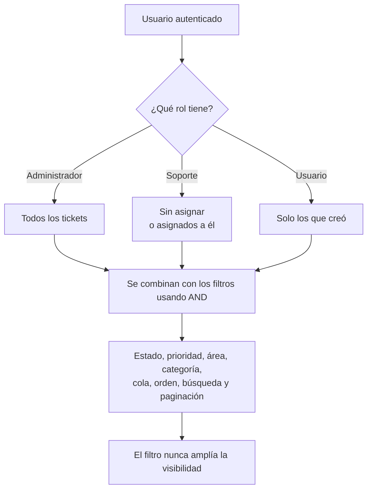

`construirWhere` compone la visibilidad y los filtros con `AND`. Un Usuario que filtre por prioridad sigue viendo solo sus tickets.

### 6.5 Código del ticket

`#TK-001`, `#TK-002`, etc.

Se calcula con `contar() + 1 + intento`, con hasta cinco reintentos si PostgreSQL rechaza por código duplicado (`P2002`). No usa una secuencia de base de datos, así que los códigos pueden tener huecos si se borran tickets.

### 6.6 Historial

Cada evento relevante escribe una fila en `historial_tickets`:

| Evento | Cuándo |
| --- | --- |
| `CREACION` | Al crear el ticket |
| `CAMBIO_ESTADO` | Cierre, aprobación o rechazo |
| `REASIGNACION` | Al asignar o reasignar |
| `CAMBIO_PRIORIDAD` | Al editar la prioridad |
| `PROPUESTA_SOLUCION` | Al proponer una solución |

El frontend mezcla historial y mensajes en una sola línea de tiempo (`lib/timeline.ts`). `PROPUESTA_SOLUCION` se descarta porque el mensaje que la originó ya representa el evento.

### 6.7 Listado y orden

`GET /tickets` acepta:

- `estado`, `prioridad`, `area_id`, `categoria_id`, `buscar`.
- `asignado`: `todos`, `sin_asignar`, `mios`.
- `orden`: `recientes`, `actualizados`, `prioridad`.
- `pagina` y `limite` (máximo 100).

Orden por defecto: `creado_en desc, id asc`. El desempate por `id` mantiene estables las páginas.

---

## 7. Mensajes, HTML y adjuntos

### 7.1 Editor y saneado

El compositor usa TipTap. El mensaje se guarda como HTML, no como texto plano, para conservar negritas, listas, enlaces e imágenes incrustadas.

Antes de persistir, `sanitizarHtml` aplica una lista blanca:

| Permitido | Valores |
| --- | --- |
| Etiquetas | `p`, `br`, `strong`, `b`, `em`, `i`, `u`, `s`, `h2`, `h3`, `ul`, `ol`, `li`, `blockquote`, `code`, `pre`, `a`, `img` |
| Atributos de `a` | `href`, `rel`, `target` |
| Atributos de `img` | `src`, `alt`, `width`, `height` |
| Esquemas | `http`, `https`, `mailto` |

Los enlaces se fuerzan a `rel="noopener noreferrer"` y `target="_blank"`. No se permiten rutas protocol-relative.

Esto se aplica en el servidor. La interfaz confía en el HTML almacenado porque ya fue saneado.

### 7.2 Flujo de una imagen

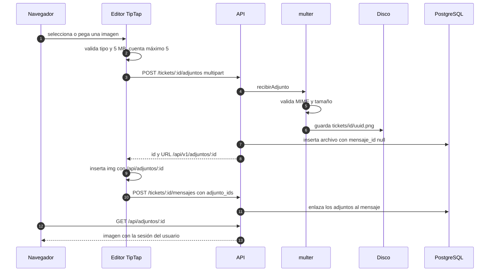

### 7.3 Reglas de adjuntos

- Máximo 5 MB por imagen.
- Tipos: PNG, JPEG, WebP y GIF.
- Máximo 5 imágenes por mensaje.
- Se sube primero y se enlaza al enviar el mensaje.
- `adjunto_ids` se deriva del HTML del editor, no de un estado acumulado. Si el usuario borra una imagen del editor, no se enlaza.
- Cada adjunto tiene propietario y ticket; no se puede enlazar dos veces ni usar el de otro ticket.
- Un ticket cerrado o resuelto no admite adjuntos nuevos.
- `GET /adjuntos/:id` aplica la misma visibilidad que el ticket.
- Las imágenes se muestran a través de `app/api/adjuntos/[id]/route.ts`, un proxy de Next que añade la cookie de sesión. Así el `` funciona sin exponer el token en la URL.
- `pnpm db:limpiar-adjuntos [horas]` borra adjuntos con `mensaje_id = null` más antiguos que el umbral, fila y archivo.

### 7.4 Comparación de rutas

El editor guarda `/api/adjuntos/<id>` y la API expone `/api/v1/adjuntos/<id>`. Para decidir si una imagen ya está incrustada se compara por `id`, nunca por URL. Comparar por URL duplicaría cada imagen en la lista de adjuntos.

---

## 8. Notificaciones y correo

### 8.1 Quién recibe qué

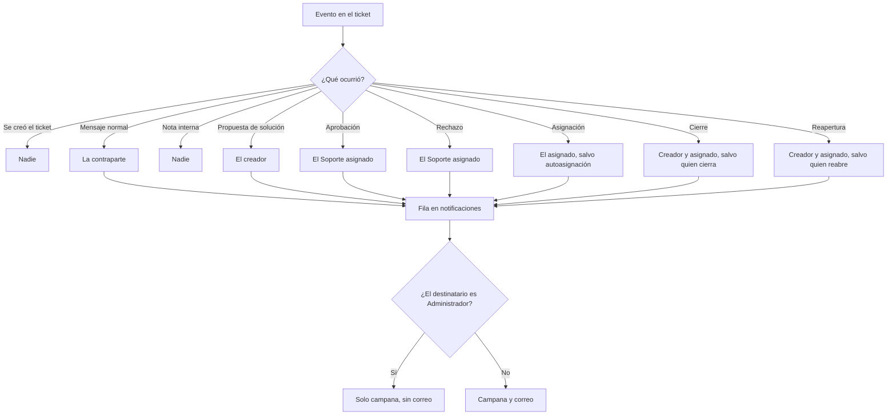

La contraparte de un mensaje normal es:

- Si escribe el Usuario, recibe el Soporte asignado.
- Si escribe Soporte o Administrador, recibe el creador.

### 8.2 Implementación

`TicketsService.notificar` es el único punto que crea notificaciones:

1. Inserta la fila en `notificaciones`.
2. Busca el rol del destinatario.
3. Si es Administrador, termina.
4. Si no, llama a `correoService.enviarCorreo`.

`enviarCorreo` captura los errores de SMTP y devuelve `false`. Nunca lanza, para que un fallo de correo no convierta en `500` una operación que ya se guardó.

### 8.3 Plantillas

| Plantilla | Uso |
| --- | --- |
| `MENSAJE_NUEVO` | Respuesta normal |
| `SOLUCION_PROPUESTA` | Propuesta de solución |
| `ESTADO_CAMBIADO` | Asignación, cierre, reapertura, aprobación y rechazo |

Cada plantilla genera HTML y texto. El asunto es `<código>: <asunto>` y el cuerpo incluye un enlace al ticket con `FRONTEND_URL`.

### 8.4 Entornos de correo

- Con `SMTP_HOST` definido, usa Nodemailer.
- Sin `SMTP_HOST`, usa un servicio simulado que imprime en consola.
- En desarrollo, Mailpit captura todo en `http://localhost:8025`.

### 8.5 Campana

- Componente `CampanaNotificaciones` en el navbar.
- Consulta cada 60 segundos y al volver a la pestaña (`visibilitychange`).
- El contador muestra las no leídas.
- Al abrir una notificación, la marca como leída.
- `notificaciones:actualizadas` es un evento del navegador para refrescar la campana sin acoplar componentes.

---

## 9. Analíticas

### 9.1 Flujo

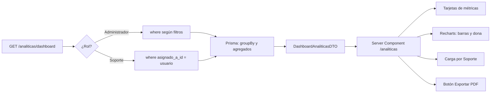

El cálculo se hace en el repositorio con consultas en paralelo: conteo por estado, usuarios, tickets cerrados y carga por Soporte. El frontend solo recibe el resumen.

### 9.2 Qué cuenta cada métrica

| Métrica | Cálculo |
| --- | --- |
| Tickets activos | `Abierto` + `En_proceso` + `En_revision` |
| Tickets resueltos | `En_revision` (propuestas pendientes de aprobación) |
| Tickets cerrados | `Cerrado` |
| Total de tickets | Suma de todos los estados |
| Usuarios registrados | Todos, sin importar estado |
| Usuarios activos | `Activo` |
| Usuarios inactivos | `Inactivo` + `Baja` |
| Tiempo promedio de cierre | Promedio de horas entre `creado_en` y `fecha_cierre` de los tickets cerrados |
| Carga por Soporte | Tickets activos agrupados por `asignado_a_id` |

Dos matices importantes para explicar:

- **`Resuelto` no se cuenta.** El estado existe por datos antiguos, pero la aplicación ya no lo produce. Lo que el cliente ve como "resueltos" son propuestas pendientes de aprobar.
- **Activos y resueltos se solapan.** `En_revision` suma en ambas cifras. Es intencional: una propuesta sigue siendo trabajo abierto. El PDF no debe leerse como una partición del total.

### 9.3 Alcance por rol

- **Administrador:** métricas globales y filtros por fecha, área, categoría y Soporte.
- **Soporte:** solo sus tickets asignados; los filtros se combinan con esa visibilidad.
- **Usuario:** `403`.
- Sin sesión: `401`.

La página también bloquea el acceso visual según el rol, pero la API es la que manda.

---

## 10. Exportación a PDF

### 10.1 Flujo

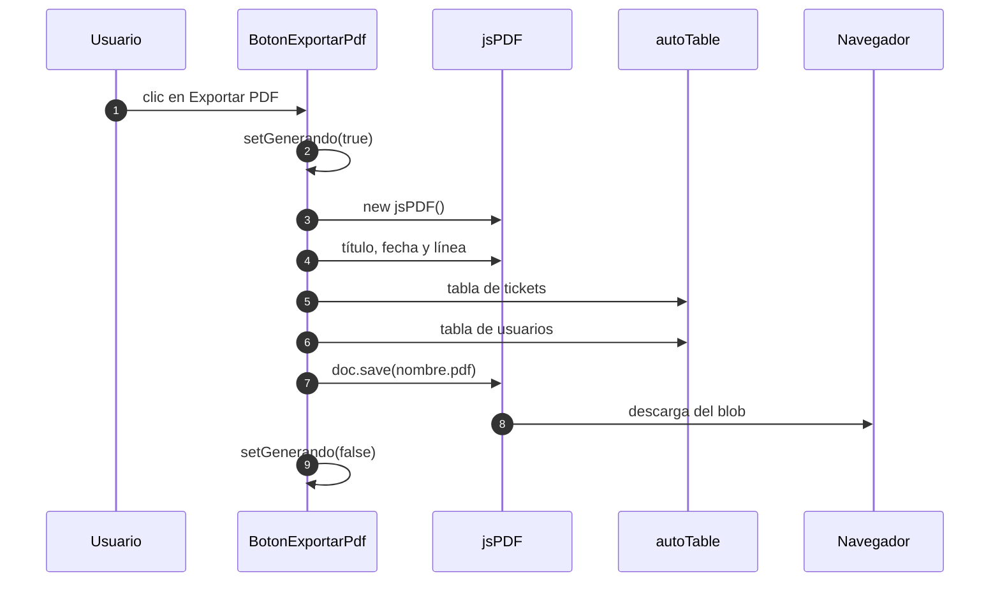

### 10.2 Contenido

- Título, fecha de generación y periodo aplicado.
- Resumen de tickets: activos, resueltos, cerrados y total, con porcentaje.
- Resumen de usuarios: registrados, activos e inactivos, con porcentaje.
- Encabezados con el índigo del sistema y filas alternas.

### 10.3 Características y límites

- Se genera en el navegador, sin endpoint ni servicio externo.
- Usa los datos ya cargados en la página; no vuelve a consultar la API.
- El archivo se descarga directamente y no se guarda en el servidor.
- Si el navegador bloquea descargas automáticas, no se genera el archivo.
- No incluye gráficas, solo tablas.

---

## 11. Frontend por dentro

### 11.1 Renderizado

Las páginas de tickets, usuarios, notificaciones, analíticas y perfil son Server Components. Leen cookies y parámetros de búsqueda, y por eso declaran:

```ts
export const instant = false;
```

Con Cache Components activado en Next 16, esa marca permite que la ruta bloquee en el servidor en lugar de intentar prerenderizar una shell estática. Es necesario porque la sesión se lee de una cookie.

Los componentes cliente se reservan para interacción: filtros, formularios, editor, campana y diálogos.

### 11.2 Petición SSR

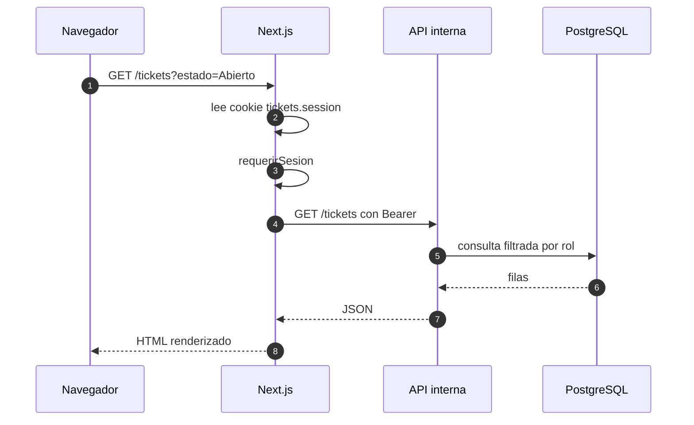

- `API_URL_INTERNA` apunta a `http://app:3000/api/v1` dentro de Compose.
- `NEXT_PUBLIC_API_URL` es la URL que usa el navegador y se inyecta en el build.
- Mezclar ambas rompe el SSR dentro de Docker.
- `fetchConSesion` redirige a `/login` si no hay sesión y a `/login?motivo=expirada` si la API devuelve `401`.
- `obtenerTicket` convierte `404` en `notFound()`.

### 11.3 Rutas

| Ruta | Tipo | Contenido |
| --- | --- | --- |
| `/` | Server | Redirige a `/tickets` o `/login` |
| `/login` | Server + cliente | Formulario, marca lateral y aviso de sesión expirada |
| `/tickets` | Server | Listado, filtros, cola, orden y paginación |
| `/tickets/nuevo` | Server + cliente | Formulario con borrador en `sessionStorage` |
| `/tickets/[id]` | Server | Detalle, timeline, metadatos y compositor |
| `/users` | Server + cliente | Tabla paginada, alta, edición, baja, reactivación y contraseña |
| `/catalogos` | Server + cliente | Áreas y categorías: alta, edición, estado y baja |
| `/auditoria` | Server | Registro de acciones administrativas |
| `/notificaciones` | Server + cliente | Bandeja y marcado de leídas |
| `/analiticas` | Server | Métricas, filtros, gráficas y PDF |
| `/perfil` | Server + cliente | Datos de la cuenta y cambio de contraseña |
| `/api/adjuntos/[id]` | Route Handler | Proxy de imágenes con la cookie |
| `not-found` | Server | 404 |

### 11.4 Datos y estado

- `lib/api.ts` centraliza `fetch`, añade `Authorization` y convierte errores en `ApiError`.
- `apiFetch` usa el token del navegador.
- `apiRequest` acepta token y URL explícitos; lo usa el servidor.
- No hay gestor de estado global. Cada página trae sus datos y los componentes cliente reciben props.
- La sesión se sincroniza con `useSyncExternalStore` en `lib/sesion.ts`.
- La lista de tickets guarda filtros en la URL y los reconstruye con `lib/consulta-tickets.ts`.

### 11.5 Componentes

- `components/ui/` es shadcn/ui: primitivas de Radix con estilos del sistema. No se modifican a mano salvo tokens.
- `components/layout/navbar.tsx` decide enlaces por rol y muestra el menú móvil.
- `components/tickets/` agrupa tabla, tarjetas móviles, filtros, editor, compositor, timeline, asignación, propuesta y acciones.
- `components/usuarios/` agrupa tabla, modal y credenciales temporales.
- `components/analiticas/` agrupa tarjetas, gráficas y exportación.
- `components/notificaciones/` agrupa campana y lista.
- `components/catalogos/` agrupa la gestión de áreas y categorías.
- `components/auditoria/` agrupa el filtro del historial.
- `components/perfil/` agrupa el cambio de contraseña.
- `components/auth/` agrupa formulario y columna de identidad del login.

### 11.6 Formularios

- `react-hook-form` + `zod` validan en cliente.
- La API vuelve a validar con Zod; el cliente nunca es la única barrera.
- Los formularios marcan campos obligatorios y usan `aria-describedby` para errores.
- El formulario de ticket guarda un borrador en `sessionStorage` y pide confirmación al descartarlo.
- La subida de imágenes se hace antes de enviar el mensaje.

### 11.7 Responsive

- Tailwind 4 con breakpoints estándar.
- Listados con tabla en escritorio y tarjetas en móvil.
- Navbar con menú desplegable por debajo de `md`.
- Verificado de 320 a 1920 px sin scroll horizontal.
- Diálogos con ancho máximo y márgenes de 16 px en pantallas pequeñas.

### 11.8 Marca

`lib/marca.ts` concentra `NOMBRE_SISTEMA` y `DESCRIPCION_SISTEMA`. El login, el navbar y los metadatos los leen de ahí. Para rebrandear solo se edita ese archivo.

---

## 12. Seguridad

Medidas implementadas:

- **Contraseñas con argon2.** Nunca se guardan en claro ni se devuelven en las respuestas.
- **Contraseña temporal.** El administrador la ve una sola vez al crear la cuenta.
- **Sin registro público.** Solo un administrador crea usuarios.
- **JWT firmado.** Secreto de mínimo 32 caracteres validado al arrancar.
- **Validación del payload.** El middleware no confía en el contenido del token.
- **Permisos en el servidor.** Ocultar un botón no sustituye la comprobación en el servicio.
- **Aislamiento por rol.** Un Usuario no puede leer tickets ni adjuntos ajenos.
- **Saneado de HTML.** Lista blanca de etiquetas, atributos y esquemas.
- **Validación de archivos.** MIME permitido, 5 MB, un archivo por petición.
- **Validación de UUID.** Evita consultas con identificadores arbitrarios.
- **Cambio de contraseña.** El usuario confirma la actual; el administrador puede generar una temporal nueva.
- **Auditoría.** Las acciones administrativas quedan registradas con usuario, entidad y fecha.
- **Sin `httpOnly` en la cookie de sesión.** Es una limitación consciente de este proyecto: Next necesita leerla en el servidor y no hay middleware de Next. En producción se movería a cookies `httpOnly` gestionadas por el backend.

Riesgos conocidos y aceptados:

- El token se guarda en `localStorage`, accesible desde JavaScript. Un XSS podría robarlo; por eso el HTML se sanea.
- No hay refresh token ni revocación. Un token robado es válido hasta que expira.
- No hay rate limiting en el login.
- No hay bloqueo por intentos fallidos.
- El modo oscuro tiene tokens, pero no está habilitado.

---

## 13. Operación y pruebas

### 13.1 Docker Compose

Perfil `dev` (por defecto):

| Servicio | Puerto | Función |
| --- | --- | --- |
| `db` | interno 5432 | PostgreSQL 17 |
| `migrate` | — | Migraciones y seed |
| `app` | 3000 | API Express |
| `frontend` | 3001 | Next.js en modo desarrollo |
| `mailpit` | 8025 | Captura de correo |

Perfil `prod`: `app-prod` en 8080 y `frontend-prod` en 8081.

Perfiles `tunnel-dev` y `tunnel-prod`: añaden contenedores de Cloudflare Tunnel para exponer la demo. La URL se lee en los logs y cambia al recrear el contenedor.

### 13.2 Variables de entorno

Solo `COMPOSE_PROFILES` y `JWT_SECRET` son obligatorias. El resto tiene valores por defecto en Compose.

| Variable | Uso |
| --- | --- |
| `COMPOSE_PROFILES` | `dev`, `prod`, `dev,tunnel-dev`, `prod,tunnel-prod` |
| `JWT_SECRET` | Firma del token, mínimo 32 caracteres |
| `JWT_EXPIRES_IN` | Duración en segundos, por defecto 3600 |
| `POSTGRES_USER`, `POSTGRES_PASSWORD`, `POSTGRES_DB` | Base de datos |
| `NEXT_PUBLIC_API_URL` | API para el navegador; se inyecta en build |
| `API_URL_INTERNA` | API para SSR dentro de Compose |
| `FRONTEND_URL` | Enlaces en correos |
| `SMTP_HOST`, `SMTP_PORT`, `SMTP_SECURE`, `SMTP_USER`, `SMTP_PASS`, `SMTP_FROM` | Correo saliente |
| `SEED_DEMO` | Carga 60 tickets y 15 usuarios en cada arranque |
| `UPLOADS_DIR` | Carpeta de imágenes |

### 13.3 Comandos

```bash
cp .env.example .env
docker compose up -d --build

cd backend && pnpm lint && pnpm typecheck && pnpm test
cd frontend/tickets_frontend && pnpm lint && pnpm test && pnpm build
```

Datos de demostración:

```bash
docker compose exec app pnpm db:demo
docker compose exec app pnpm db:demo --tickets=20
docker compose exec app pnpm db:demo:limpiar
docker compose exec app pnpm db:limpiar-adjuntos 48
```

### 13.4 Pruebas

| Nivel | Cantidad | Qué verifica |
| --- | --- | --- |
| Unitarias backend | 70 | Reglas de servicio con repositorios simulados |
| Integración backend | 63 | HTTP real, Express real y PostgreSQL 17 en Testcontainers |
| Frontend | 105 | Componentes, sesión, API y utilidades en jsdom |

La integración ejecuta migraciones y seed reales. Cubre autenticación, usuarios, contraseñas, catálogos, ciclo completo del ticket, reapertura, filtros, aislamiento, adjuntos, notificaciones, auditoría, analíticas y salud.

No hay pruebas de navegador automatizadas. La verificación visual y de flujo se hace manualmente.

---

## 14. Guion de demo para el cliente

Duración sugerida: 7 a 10 minutos. Orden pensado para que cada paso prepare el siguiente.

1. **Login como Administrador.** Mostrar la columna de identidad y el ciclo de estados. Entrar en `/users`.
2. **Crear un usuario de Soporte.** Enseñar la contraseña temporal y el botón de copiar. Explicar que no hay registro público.
3. **Editar, dar de baja, reactivar y restablecer contraseña.** Mostrar que la baja impide el acceso.
4. **Abrir `/catalogos`.** Crear un área y una categoría, y mostrar su activación.
5. **Entrar como Usuario.** Crear un ticket con categoría, área y prioridad. Explicar el código `#TK-###`.
6. **Adjuntar una imagen.** Mostrar el diálogo de texto alternativo y la imagen incrustada.
7. **Entrar como Soporte.** Abrir el ticket, intentar responder antes de tomarlo y enseñar el aviso. Tomar el ticket.
8. **Nota interna, respuesta y propuesta.** Explicar que la nota interna no la ve el cliente y que la propuesta pasa el ticket a revisión.
9. **Volver como Usuario.** Mostrar la campana, la propuesta y aprobar. El ticket queda cerrado.
10. **Como Administrador.** Reabrir el ticket y explicar la reapertura.
11. **Abrir `/analiticas`.** Aplicar un filtro, explicar las métricas y exportar el PDF.
12. **Abrir `/auditoria`.** Mostrar el registro de las acciones realizadas.
13. **Cerrar con el correo.** Abrir Mailpit o el buzón real y mostrar las notificaciones enviadas.

Frases útiles:

- "Las reglas están en el servidor: aunque alguien manipule la interfaz, la API rechaza la acción."
- "Cada cambio queda en el historial; nada se sobrescribe sin rastro."
- "El correo es un aviso, no el canal principal. Si falla el SMTP, la operación ya quedó guardada."

---

## 15. Glosario y limitaciones

### 15.1 Glosario

| Término | Significado |
| --- | --- |
| Ticket | Incidencia registrada con código único |
| Cola | Filtro de asignación: todos, sin asignar o míos |
| Propuesta de solución | Mensaje de Soporte que pasa el ticket a `En_revision` |
| Nota interna | Mensaje visible solo para Soporte y Administración |
| Adjunto suelto | Imagen subida pero todavía no enlazada a un mensaje |
| Timeline | Mezcla ordenada de mensajes e historial |
| SSR | Renderizado en el servidor de Next |
| Seed | Datos iniciales de roles, usuarios y catálogos |
| Demo | 60 tickets y 15 usuarios adicionales para presentaciones |
| Auditoría | Registro de acciones administrativas con usuario, entidad y fecha |

### 15.2 Limitaciones

- Soporte no se filtra por área porque `usuarios` no tiene `area_id`.
- El cierre por inactividad no está implementado.
- El modo oscuro tiene tokens pero no está habilitado.
- No hay refresh token.
- La auditoría registra acciones administrativas y de catálogo; los mensajes de ticket se consultan en su historial.
- No hay pruebas end-to-end de navegador automatizadas.
- La URL del túnel de Cloudflare cambia al recrear el contenedor; si se usa en producción, conviene un túnel con nombre.

---

*Fin del documento.*
