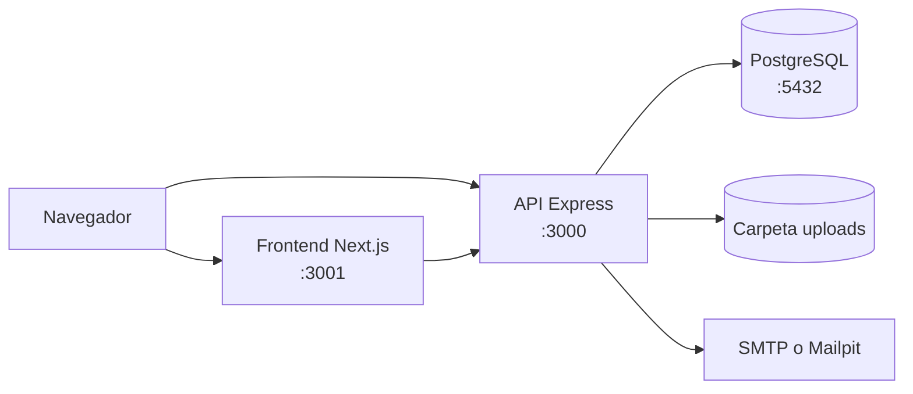
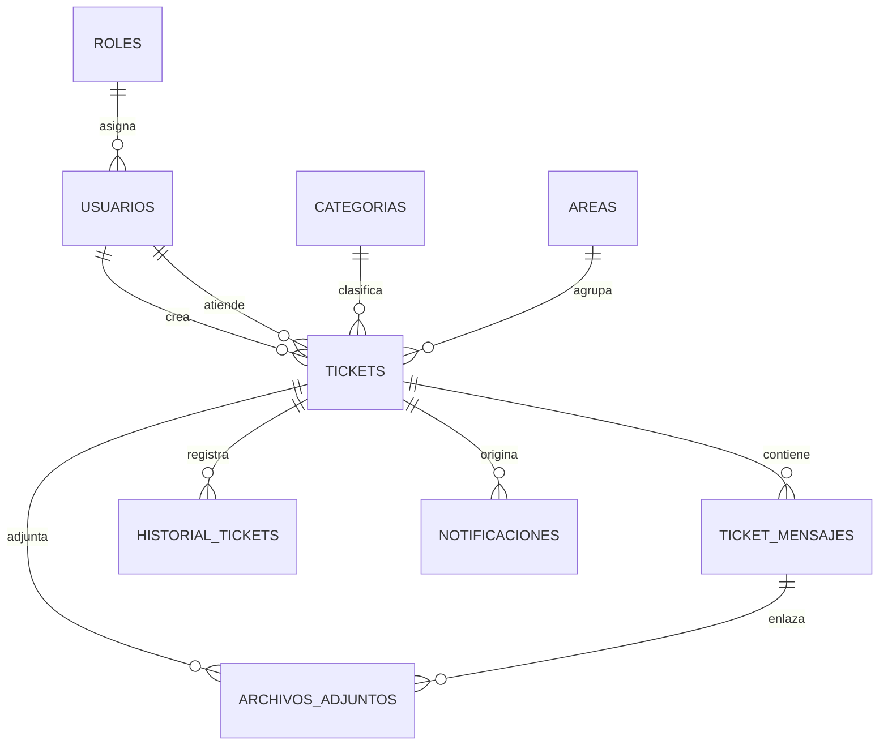
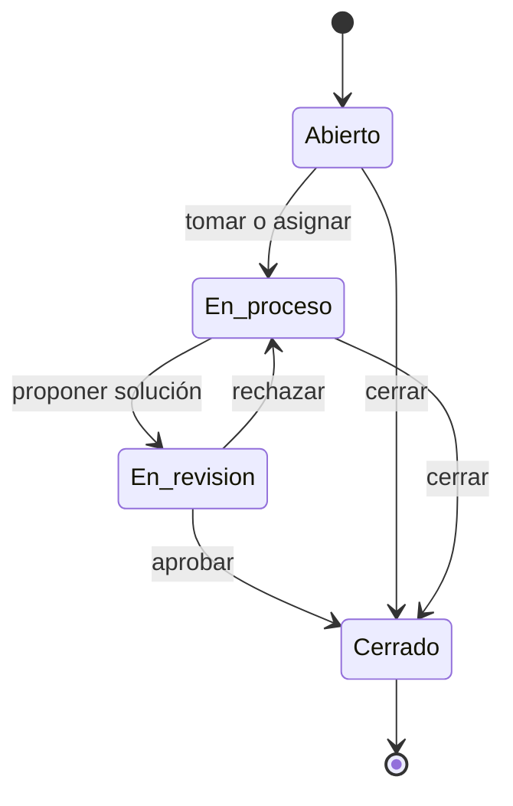

# Sistema de Tickets

Mesa de ayuda interna para reportar, atender y resolver incidencias. Cada ticket recorre un ciclo con reglas en servidor, historial, notificaciones y una propuesta de solución que el creador aprueba o rechaza.

**Stack:** Node 24 + Express 5 + Prisma 7 + PostgreSQL 17 · Next.js 16 + React 19 + Tailwind 4 + shadcn/ui · Docker Compose.

## Arranque rápido

```bash
cp .env.example .env
docker compose up -d --build
```

- Frontend: <http://localhost:3001>
- API: <http://localhost:3000/api/v1>
- Mailpit: <http://localhost:8025>

| Rol           | Correo                | Contraseña   |
| ------------- | --------------------- | ------------ |
| Administrador | `admin@example.com`   | `admin123`   |
| Soporte       | `soporte@example.com` | `soporte123` |
| Usuario       | `usuario@example.com` | `usuario123` |

`docker compose up` ejecuta migraciones y seed. El seed es idempotente, pero restablece las contraseñas de estas tres cuentas.

## Roles y flujo

- **Usuario:** crea tickets, responde solo en los suyos y aprueba o rechaza la solución propuesta.
- **Soporte:** ve tickets sin asignar o asignados a él. Debe tomar el ticket antes de responder, puede dejar notas internas, proponer solución y cerrar los suyos.
- **Administrador:** ve todo, reasigna, edita, cierra cualquier ticket y administra usuarios, áreas y categorías. No puede darse de baja ni asignarse el rol Administrador.

```text
Abierto → En_proceso → En_revision → Cerrado
```

- Una propuesta de solución mueve el ticket a `En_revision`.
- Aprobar la propuesta lo cierra; rechazarla lo devuelve a `En_proceso`.
- `Cerrado` y `Resuelto` no admiten mensajes ni adjuntos nuevos (`400`).
- Los filtros se combinan con la visibilidad del rol: nunca amplían lo que cada rol puede ver.
- No hay registro público: un administrador crea las cuentas y muestra la contraseña temporal una sola vez.

## Diagramas

Arquitectura general:



Modelo de datos:



Ciclo de un ticket:



## Funcionalidades

- **Acceso:** login JWT, sesión de 1 h sin refresh, aviso al volver por expiración y cierre de sesión.
- **Usuarios:** alta, edición, baja y reactivación; contraseña temporal con opción de copiar.
- **Tickets:** listado con cola (`Todos`, `Sin asignar`, `Míos`), orden, filtros y paginación; creación, detalle, edición y cierre.
- **Conversación:** mensajes con HTML saneado, notas internas solo para staff, propuesta de solución, aprobación y rechazo.
- **Adjuntos:** hasta 5 imágenes de 5 MB por mensaje, con texto alternativo y enlace solo a las que siguen en el editor.
- **Actividad:** timeline que mezcla mensajes e historial; tarjeta de Soporte asignado.
- **Notificaciones:** campana, página `/notificaciones` y correo por cada evento relevante.
- **Analíticas:** dashboard para Administrador y Soporte, con gráficas y exportación a PDF.
- **Responsive:** probado de 320 a 1920 px, sin scroll horizontal.

## Datos de demostración

```bash
docker compose exec app pnpm db:demo                # 60 tickets y 15 usuarios
docker compose exec app pnpm db:demo --tickets=20   # volumen reducido
docker compose exec app pnpm db:demo:limpiar        # solo borra
```

Con `SEED_DEMO=true` en `.env`, el servicio `migrate` carga la demo en cada `up` y la recrea desde cero. No se usa en producción.

Las cuentas demo son `soporte2@demo.local` … `soporte5@demo.local` y `usuario2@demo.local` … `usuario12@demo.local`, todas con `demo123`. Los tickets usan el prefijo `#D-` y reparten estados entre abiertos, en proceso, en revisión, resueltos y cerrados. La limpieza no toca las cuentas base, los catálogos ni el ticket `#TK-DEMO`.

## API

Prefijo: `/api/v1`.

| Módulo         | Rutas                                                                                                    | Acceso                      |
| -------------- | -------------------------------------------------------------------------------------------------------- | --------------------------- |
| Autenticación  | `POST /autenticacion/login` · `GET /autenticacion/perfil`                                                | Público · JWT               |
| Salud          | `GET /salud`                                                                                             | Público                     |
| Usuarios       | `GET/POST /users` · `PATCH/DELETE /users/:id`                                                            | JWT + Administrador         |
| Roles          | `GET /roles`                                                                                             | JWT + Administrador         |
| Áreas          | `GET /areas` · `POST /areas` · `PATCH /areas/:id`                                                        | JWT · Administrador         |
| Categorías     | `GET /categorias` · `POST /categorias` · `PATCH /categorias/:id`                                         | JWT · Administrador         |
| Tickets        | `GET/POST /tickets` · `GET/PATCH /tickets/:id`                                                           | JWT · Administrador (PATCH) |
| Ciclo          | `POST /tickets/:id/asignar` · `PATCH /tickets/:id/estado` · `POST /tickets/:id/aprobar` · `.../rechazar` | Admin o Soporte · Creador   |
| Conversación   | `GET/POST /tickets/:id/mensajes` · `GET /tickets/:id/historial`                                          | JWT                         |
| Adjuntos       | `POST /tickets/:id/adjuntos` · `GET /adjuntos/:id`                                                       | JWT (autorizado)            |
| Notificaciones | `GET /notificaciones` · `PATCH /notificaciones/leidas` · `PATCH /notificaciones/:id/leida`               | JWT                         |
| Analíticas     | `GET /analiticas/dashboard`                                                                              | JWT + Admin o Soporte       |

`GET /tickets` acepta `estado`, `prioridad`, `area_id`, `categoria_id`, `buscar`, `asignado` (`todos`, `sin_asignar`, `mios`), `orden` (`recientes`, `actualizados`, `prioridad`), `pagina` y `limite` (máximo 100). Devuelve `{ message, data, meta }` con `meta = { pagina, limite, total, total_paginas }`.

`GET /areas` acepta `?activo=true|false|all`. Los formularios de ticket deben usar `activo=true`.

## Comandos

| Acción                     | Comando                                                                     |
| -------------------------- | --------------------------------------------------------------------------- |
| Levantar / reconstruir     | `docker compose up -d --build`                                              |
| Enlace público dev         | `COMPOSE_PROFILES=dev,tunnel-dev docker compose up -d`                      |
| Enlace público prod        | `COMPOSE_PROFILES=prod,tunnel-prod docker compose up -d --build`            |
| Cambiar de perfil          | `docker compose down --remove-orphans` y ajustar `COMPOSE_PROFILES`         |
| Logs / shell               | `docker compose logs -f app frontend` · `docker compose exec app sh`        |
| Verificar backend          | `cd backend && pnpm lint && pnpm typecheck && pnpm test`                    |
| Verificar frontend         | `cd frontend/tickets_frontend && pnpm lint && pnpm test && pnpm build`      |
| Formatear                  | `pnpm format` dentro de `backend` o `frontend/tickets_frontend`             |
| Nueva migración            | `docker compose exec app pnpm prisma migrate dev --name <nombre>`           |
| Seed base                  | `docker compose exec app pnpm db:seed`                                      |
| Limpiar adjuntos huérfanos | `docker compose exec app pnpm db:limpiar-adjuntos [horas]` (24 por defecto) |
| Demo                       | `docker compose exec app pnpm db:demo [--tickets=N]`                        |
| Borrar demo                | `docker compose exec app pnpm db:demo:limpiar`                              |
| Apagar                     | `docker compose down` · `docker compose down -v` borra BD y uploads         |

Los perfiles `tunnel-*` levantan el túnel de Cloudflare. Los pasos completos están en «Enlace público con Cloudflare Tunnel», dentro de la sección Producción.

Los tests de backend usan Testcontainers: necesitan Docker y pnpm en el host, y un `backend/.env` con `DATABASE_URL` y `JWT_SECRET` (mínimo 32 caracteres). Los del frontend corren en jsdom, sin Docker.

## Pruebas de API con Postman

La colección está en `postman/tickets.postman_collection.json` y se importa desde Postman con File → Import. Contiene 16 peticiones ordenadas: inicia sesión con los tres roles, crea un ticket, lo asigna, lo responde, propone una solución y lo cierra.

La variable `baseUrl` apunta a `http://localhost:3000/api/v1` por defecto. Si la API está en otra dirección, se cambia en la pestaña Variables de la colección.

```bash
npx newman run postman/tickets.postman_collection.json
```

La ejecución completa crea un ticket de prueba y lo deja cerrado.

## Reporte con K6

El script `k6/prueba.js` consulta cuatro endpoints: salud, inicio de sesión, listado de tickets y notificaciones. Al terminar genera un reporte en `k6/index.html`.

```bash
cd k6
k6 run prueba.js
```

Con Docker:

```bash
cd k6
docker run --rm -i --network host -v "$PWD:/k6" -w /k6 grafana/k6 run prueba.js
```

La dirección de la API se cambia con `-e BASE_URL=...` y las credenciales con `-e CORREO=... -e CONTRASENA=...`.

## Estructura

```text
.
├── backend/
│   ├── prisma/          schema, migraciones, seed y assets
│   ├── scripts/         datos demo y limpieza de adjuntos
│   └── src/
│       ├── modules/     autenticacion, usuarios, roles, areas, categorias, tickets, analiticas
│       ├── middlewares/ auth, errores, 404
│       ├── routes/      registro de routers
│       └── test/        unit e integration
├── frontend/tickets_frontend/
│   ├── app/             login, tickets, users, analiticas, notificaciones, perfil
│   ├── components/      UI, layouts y flujos
│   ├── lib/             API, sesión, consultas y helpers de servidor
│   └── test/
├── postman/             colección de pruebas de la API
├── k6/                  prueba de carga
└── docker-compose.yml
```

## Variables de entorno

Solo `COMPOSE_PROFILES` y `JWT_SECRET` son obligatorias. El resto tiene valor por defecto en `docker-compose.yml`: solo es necesario definirlas en `.env` para cambiar ese valor.

| Variable                               | Por defecto                    | Uso                                        |
| -------------------------------------- | ------------------------------ | ------------------------------------------ |
| `COMPOSE_PROFILES`                     | `dev`                          | `dev`, `prod` + `tunnel-dev`/`tunnel-prod` |
| `JWT_SECRET`                           | —                              | Firma JWT, mínimo 32 caracteres            |
| `NEXT_PUBLIC_API_URL`                  | `:3000` (dev) / `:8080` (prod) | API del navegador; se compila en prod      |
| `FRONTEND_URL`                         | `:3001` (dev) / `:8081` (prod) | Enlaces en los correos                     |
| `API_URL_INTERNA`                      | `app:3000` / `app-prod:3000`   | API para SSR dentro de Compose             |
| `POSTGRES_USER`                        | `postgres`                     | Usuario de PostgreSQL                      |
| `POSTGRES_PASSWORD`                    | `postgres`                     | Contraseña de PostgreSQL                   |
| `POSTGRES_DB`                          | `tickets`                      | Nombre de la base                          |
| `JWT_EXPIRES_IN`                       | `3600`                         | Duración del token en segundos             |
| `SMTP_HOST`                            | `mailpit`                      | Vacío: solo imprime correos en consola     |
| `SMTP_PORT`                            | `1025`                         | Puerto SMTP                                |
| `SMTP_SECURE`                          | `false`                        | `true` para TLS implícito (465)            |
| `SMTP_USER` / `SMTP_PASS`              | —                              | Credenciales SMTP                          |
| `SMTP_FROM`                            | `Sistema de Tickets <…>`       | Remitente                                  |
| `SEED_DEMO`                            | `false`                        | Carga la demo en cada `up`                 |
| `CLOUDFLARE_TUNNEL_PROTOCOL`           | `quic`                         | `http2` si la red bloquea UDP/7844         |
| `APP_PORT` / `FRONTEND_PORT`           | `3000` / `3001`                | Puertos dev                                |
| `APP_PROD_PORT` / `FRONTEND_PROD_PORT` | `8080` / `8081`                | Puertos prod                               |

## Producción

```bash
COMPOSE_PROFILES=prod
POSTGRES_PASSWORD=<segura>
JWT_SECRET=<mínimo 32 caracteres>
NEXT_PUBLIC_API_URL=http://IP_O_DOMINIO:8080/api/v1
```

```bash
docker compose up -d --build
```

Frontend en `:8081`, API en `:8080/api/v1`. `NEXT_PUBLIC_API_URL` se compila dentro de la imagen: si cambia, hay que reconstruir `frontend-prod`. Para 80/443 se usa un reverse proxy.

### Enlace público con Cloudflare Tunnel

Sirve para enseñar producción por un enlace temporal, sin abrir puertos. Añade el perfil del túnel en `.env`:

```bash
COMPOSE_PROFILES=prod,tunnel-prod
```

El túnel debe existir **antes** de construir el frontend, porque la URL del API se compila dentro de la imagen. Tres pasos:

```bash
# 1. Se arrancan solo los túneles y se copian las dos URLs de los logs
COMPOSE_PROFILES=tunnel-prod docker compose up -d
docker compose logs cloudflared-prod-backend  | grep -o 'https://[a-z0-9-]*\.trycloudflare\.com'
docker compose logs cloudflared-prod-frontend | grep -o 'https://[a-z0-9-]*\.trycloudflare\.com'

# 2. Se escriben las URLs en .env
#    NEXT_PUBLIC_API_URL=https://<backend>.trycloudflare.com/api/v1
#    FRONTEND_URL=https://<frontend>.trycloudflare.com

# 3. Se construye y se arranca todo
docker compose up -d --build
```

- La URL que se comparte es la de `cloudflared-prod-frontend`.
- El API queda en la URL de `cloudflared-prod-backend` + `/api/v1`.

En **dev** el procedimiento es más corto porque no hay build: se usa `COMPOSE_PROFILES=dev,tunnel-dev`, se arrancan los túneles, se copian las URLs a `NEXT_PUBLIC_API_URL` y `FRONTEND_URL`, y se ejecuta `docker compose up -d frontend`.

Las dos URLs son únicas para dev y prod: al cambiar de entorno hay que ajustar o comentar sus valores, y no se deben tener los dos arriba a la vez con enlaces propios.

La URL cambia cada vez que se recrea el contenedor del túnel; en producción eso obliga a repetir el paso 2. El enlace es público y sin autenticación: se usa solo durante la demo y se apaga volviendo a `COMPOSE_PROFILES=prod` seguido de `docker compose down --remove-orphans`.

## Limitaciones

- La UI de catálogos (áreas y categorías) aún no existe; se administran por API.
- Soporte no se filtra por área: el schema no relaciona usuarios con áreas.
- El cierre por inactividad no está implementado.
- El modo oscuro tiene tokens pero no está habilitado.
- El nombre y la descripción visibles están en `frontend/tickets_frontend/lib/marca.ts`; cámbialos ahí para rebrandear.
